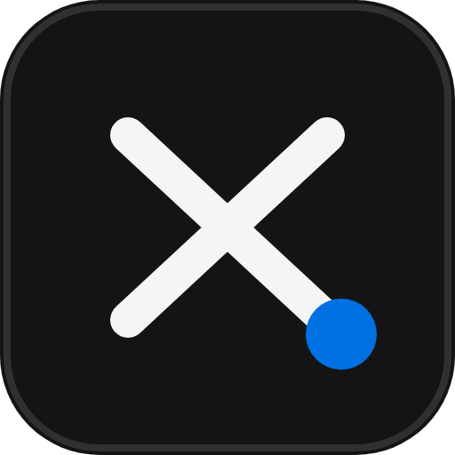

<div align="center">



# XHANNIZER0

**Deja Windows listo después de formatear o armar tu PC, sin anuncios ni instaladores ocultos.**

Una app gratuita de [xhanni (Xhanni Studios)](https://xhannistudios.org).


[](https://github.com/Xanssj/XHANNIZER0/actions/workflows/tests.yml)

[Descargar](https://github.com/Xanssj/XHANNIZER0/releases/latest) · [Soporte en Discord](https://discord.gg/QKmUekvX2X) · [Privacidad](PRIVACY.md) · [Marca](TRADEMARK.md) · [Cambios](CHANGELOG.md)

</div>

---

## Qué hace

**🖥️ Resumen y monitor en vivo.** Vista inicial con estado general de tu PC, checklist post-formateo, copia de especificaciones en 1 clic y **monitor en vivo** (CPU, RAM, disco del sistema y temperatura de GPU NVIDIA) con pausa automática. Interfaz fluida a 60–240 Hz con animaciones nativas de Windows 11, modo oscuro/claro, inglés/español y paleta de comandos **Spotlight (`Ctrl + K`)**.

**🚀 Piloto automático.** Un botón deja tu PC recién formateado listo: respaldo, punto de restauración, drivers, runtimes, tus apps, ajustes de Windows, limpieza y chequeo final. Si hace falta reiniciar, la app se vuelve a abrir sola y sigue donde quedó, con **notificaciones nativas de Windows** al terminar.

**🩺 Chequeo de PC.** Encuentra los errores que Windows no avisa al armar o formatear: RAM sin XMP/EXPO, monitor conectado a la placa madre o atascado en 60 Hz, salud de batería en portátiles, **pantallazos azules (BSOD) y apagados inesperados (`Kernel-Power 41`)** de los últimos 30 días, Resizable BAR o Secure Boot apagados, SSD limitado y dispositivos sin driver. El **Asistente de BIOS** te muestra la ruta exacta del menú para tu placa (ASUS, MSI, Gigabyte, ASRock) y reinicia directo a la BIOS.

**🧩 Drivers con detección real de hardware.** CPU, GPU dedicada e integrada, placa madre, audio, red y almacenamiento, comparados con los canales oficiales de cada fabricante. Los dispositivos sin driver se resuelven desde Windows Update por su Hardware ID exacto.

**📦 Catálogo oficial y perfiles.** Más de 100 programas por WinGet o desde su sitio oficial (con **desinstalador integrado**), emuladores open-source desde GitHub, búsqueda en Microsoft Store y **Mis perfiles guardados** para reutilizar o compartir tus configuraciones (`XHZ1-…` o JSON).

**🌐 Windows y Red.** Ajustes post-formateo 100 % reversibles (Modo Juego, HAGS, aceleración de mouse 1:1, extensiones y archivos ocultos, plan de energía, limpieza de Windows 11, hibernación con avisos en portátiles), gestor de inicio, limpiador de bloatware seguro y **comparador de DNS en vivo** (Cloudflare, Google, Quad9, AdGuard y OpenDNS) para aplicar el más rápido en 1 clic.

**🔁 Migrar mi PC.** Antes de formatear, guarda tus programas, ajustes y carpetas en un USB; después, restáuralos en el PC nuevo sin sobrescribir nada.

**🛠️ Mantenimiento.** Reparar Windows (SFC, DISM, Windows Update), actualizar tus apps cada semana, limpiar Windows.old y cachés de sombreadores, crear puntos de restauración y ver el historial de todo lo que hizo la app.

**📊 Rendimiento e informe.** Compara tu PC antes y después de optimizarlo, prueba que la RAM aguante con XMP/EXPO y genera un **informe PDF para tu cliente** si formateas equipos por trabajo.

**🛡️ Seguro por diseño.** Cada cambio exige un respaldo verificado y se puede deshacer. Los cambios sensibles piden confirmación nativa con avisos claros, se bloquean carpetas críticas del sistema, ves el origen exacto de cada descarga (SHA-256 y firma digital) y los instaladores sin firma se bloquean. Sin cuentas, sin publicidad y sin telemetría ([detalles](PRIVACY.md)).

---

## Descargar e instalar

1. Baja la última versión desde **[Releases](https://github.com/Xanssj/XHANNIZER0/releases/latest)**:
   - `XHANNIZER0-x.x.x-x64-nsis.exe`: instalador de Windows (con actualizaciones automáticas).
2. Si Windows muestra **«Windows protegió su PC»**, toca **Más información → Ejecutar de todas formas**. Aparece mientras la app no tenga firma de código.

Necesitas Windows 10 u 11 de 64 bits. Algunas acciones piden permiso de administrador (UAC).

## Soporte

¿Algo no funciona? En la app ve a **Acerca de y soporte → Reportar un problema**: se guarda un diagnóstico `.zip` y se abre el [Discord oficial](https://discord.gg/QKmUekvX2X), donde puedes abrir un ticket. Te responde quien hizo la app.

Para fallos de seguridad, lee [SECURITY.md](SECURITY.md).

## Para desarrolladores

```powershell
git clone https://github.com/Xanssj/XHANNIZER0.git
cd XHANNIZER0
npm install
npm start
```

| Comando | Qué hace |
| --- | --- |
| `npm test` | Pruebas automáticas (29 tests) |
| `npm run dist:nsis` | Compila el instalador oficial de Windows en `dist/` |
| `npx electron scripts/build-icon.js` | Regenera `build/icon.ico` desde `assets/icon.svg` |
| `npm run validate:catalog` | Revisa que los IDs de WinGet del catálogo sigan existiendo |

**Publicar una versión:** sube la versión en `package.json`, crea la etiqueta y súbela (`git tag v2.3.0` y `git push origin v2.3.0`). GitHub Actions corre las pruebas, compila y publica la versión. Si existen los secretos `CSC_LINK` y `CSC_KEY_PASSWORD`, también la firma.

**Corregir el catálogo sin publicar una versión:** edita [`catalog-overrides.json`](catalog-overrides.json). Las apps instaladas lo descargan al abrirse.

## Licencia, marca y aviso legal

- **Licencia de código fuente:** XHANNIZER0 se entrega bajo la licencia **[GNU GPLv3](LICENSE)** (`GPL-3.0-or-later`), sin garantías: úsala bajo tu responsabilidad y mantén tus respaldos. Cualquier copia o modificación redistribuida debe mantenerse abierta bajo GPLv3 y conservar la atribución original *(las versiones anteriores hasta v2.3.0 fueron publicadas bajo licencia MIT)*.
- **Marca e identidad:** los nombres **XHANNIZER0**, **Xhanni Studios**, el logotipo oficial y el dominio `xhannistudios.org` están reservados. Si haces un fork, debes cambiar el nombre, el ícono y el `appId` — consulta [TRADEMARK.md](TRADEMARK.md).
- **Terceros:** los avisos de librerías de terceros están en [THIRD-PARTY-NOTICES.md](THIRD-PARTY-NOTICES.md). Los emuladores se descargan desde sus proyectos oficiales; XHANNIZER0 no incluye ni distribuye BIOS, firmware ni juegos. Las marcas mencionadas pertenecen a sus dueños y se nombran solo para identificar el software que instala la app.

---

<div align="center">
  <sub>Hecho por <a href="https://xhannistudios.org/nosotros">xhanni</a> · <a href="https://xhannistudios.org">xhannistudios.org</a> · <a href="https://discord.gg/QKmUekvX2X">Discord</a></sub>
</div>
