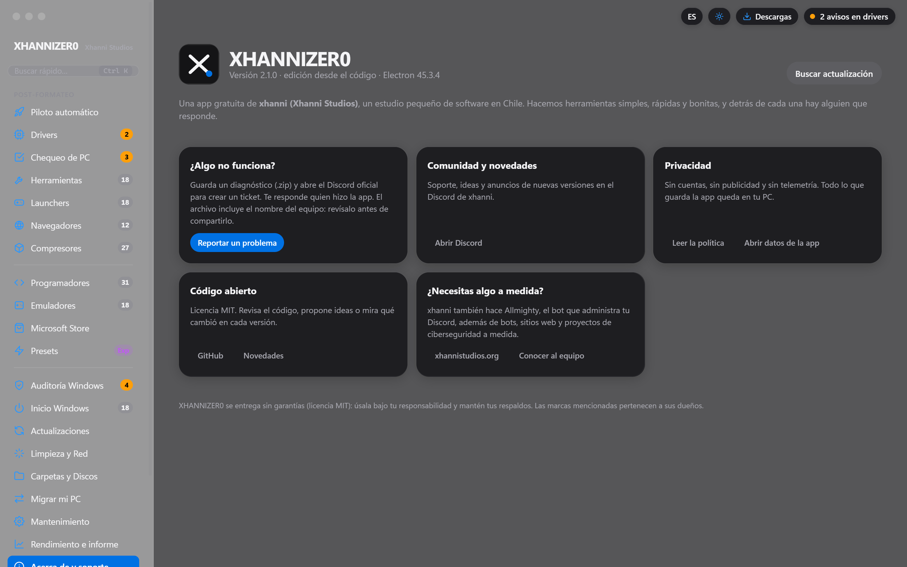

# Ajustes y Acerca de

En la parte inferior de la barra lateral encontrarás dos accesos fijos: **Ajustes** (`Ctrl + ,`) para personalizar XHANNIZER0 y **Acerca de** para consultar tu versión, actualizar la app o pedir soporte.

## Ajustes de XHANNIZER0

<!-- captura: pantalla de Ajustes mostrando Idioma, Apariencia, Modo ligero, Modo técnico, Notificaciones y Perfiles JSON -->

### Aspecto y comportamiento

- **Idioma de la interfaz:** cambia entre **Español** y **English**. Traduce toda la aplicación, las ventanas de confirmación, las novedades y el informe PDF.
- **Apariencia:** elige entre modo **Oscuro** y modo **Claro** translúcido.
- **Modo ligero (bajo consumo):** desactiva blur, sombras y animaciones 3D para máxima fluidez en equipos modestos. Tiene tres opciones:
  - **Automático** *(por defecto)*: se activa solo si tu PC tiene 8 GB de RAM o menos, 4 hilos de CPU o menos, sin GPU dedicada o con *reducir movimiento* activo en Windows (en ese caso también pausa el Monitor en vivo por defecto).
  - **Activado:** fuerza el modo ligero en cualquier equipo.
  - **Desactivado:** mantiene todos los efectos visuales completos.
- **Modo técnico:** muestra u oculta el generador de **Informe PDF para el cliente** dentro de [Rendimiento e informe](rendimiento-e-informe.md).
- **Notificaciones de Windows:** activa o desactiva las notificaciones nativas cuando termina una instalación, reparación o prueba mientras la app está minimizada.

### Perfiles, bienvenida y datos locales

- **Perfiles en JSON:** usa **Exportar** para guardar tu selección de programas y ajustes en un archivo `.json` local, o **Importar** para cargarlo en otro equipo.
- **Asistente de bienvenida:** presiona **Configuración inicial** para volver a elegir idioma, datos del equipo y uso principal.
- **Datos y respaldos:** botones directos para **Abrir respaldos** y **Abrir datos** (donde se guardan tu configuración, perfiles e historial).
- **Atajos de teclado:** recordatorio visual de `Ctrl + K`, `Ctrl + 1…9`, `Ctrl + ,` y `Esc`.

## Acerca de y soporte

En **Acerca de** puedes ver la versión instalada, comprobar actualizaciones manualmente con **Buscar actualización** y acceder a:

- **Reportar un problema:** genera un archivo de **diagnóstico `.zip`** en tu PC y abre el **[Discord oficial de xhanni](https://discord.gg/QKmUekvX2X)** para crear un ticket donde te responde el creador de la app.
- **Comunidad y novedades:** acceso directo al Discord oficial.
- **Privacidad:** enlace a la política de privacidad y acceso rápido a **Abrir datos de la app**.
- **Código abierto:** enlaces al repositorio de GitHub y al historial de novedades (Changelog).


**Sobre el diagnóstico `.zip`:** incluye el hardware detectado, el resultado del chequeo, la lista de respaldos, el historial de acciones y el registro de errores. **No contiene contraseñas ni archivos personales**, pero sí incluye el nombre de tu equipo y rutas de carpetas. XHANNIZER0 nunca lo envía solo: revísalo antes de adjuntarlo en tu ticket de Discord.

