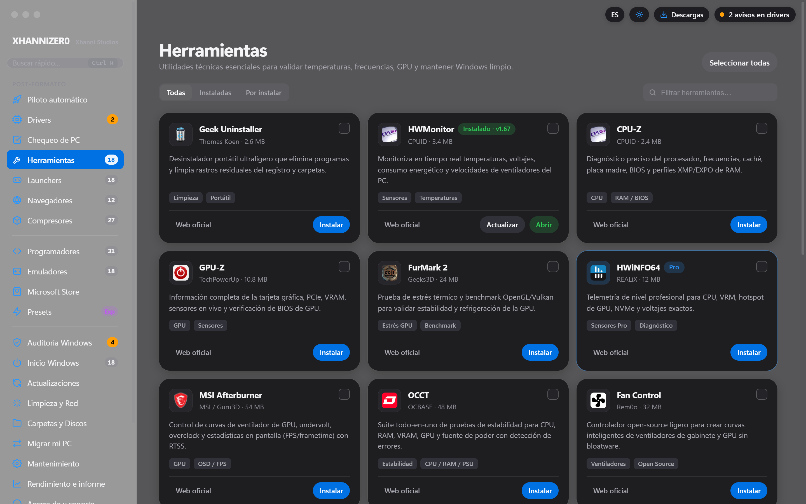

# Catálogo de programas

El **Catálogo** reúne más de 100 programas oficiales que puedes instalar de a uno o en lote mediante **WinGet**, canales oficiales del fabricante, **GitHub Releases** (en emuladores) o **Microsoft Store**.

## Categorías disponibles

Al entrar en **Programas → Catálogo**, la barra superior te permite cambiar entre las 7 categorías:

1. **Herramientas:** utilidades técnicas esenciales para medir temperaturas, frecuencias, GPU y mantenimiento del sistema.
2. **Launchers:** plataformas de juegos (como Steam y otros launchers) listas para instalar o abrir directamente si ya están presentes.
3. **Navegadores:** instalación directa o múltiple desde fuentes oficiales.
4. **Compresores:** archivadores, utilidades de archivos, video, audio y runtimes esenciales tras formatear. Incluye filtros por tipo (**Todos**, **Archivos**, **Video**, **Audio**).
5. **Programadores:** editores, IDEs, herramientas de IA para programar (en la nube y local en GPU), codeo en vivo, APIs, organización y runtimes/Git. Incluye filtros por especialidad (**IA para programar**, **IDEs y Editores**, **Codeo en vivo / APIs**, **Organización**, **Runtimes / Git**).
6. **Emuladores:** emuladores de código abierto descargados directamente desde sus repositorios oficiales de **GitHub Releases**, siempre en su última versión para Windows. Puedes filtrarlos por plataforma (**Multi-sistema**, **PlayStation**, **Nintendo**, **Xbox**, **Retro / Arcade**) y pulsar **Verificar versiones en GitHub**.
7. **Microsoft Store:** muestra aplicaciones destacadas (como Spotify, WhatsApp, Netflix, Apple Music, Telegram, EarTrumpet, TranslucentTB, iCloud, Canva o TikTok) y te permite buscar cualquier app oficial de la tienda desde el buscador integrado.


**Aviso importante sobre Emuladores:** XHANNIZER0 **no incluye ni descarga BIOS, firmware ni juegos**. Algunos emuladores los requieren para funcionar: úsalos únicamente con copias de consolas y juegos que te pertenezcan.


## Cómo buscar, instalar o desinstalar

1. Usa los filtros de estado (**Todas**, **Instaladas**, **Por instalar**) o la barra de búsqueda de cada categoría para encontrar lo que necesitas.
2. Haz clic en los programas que quieras instalar (o usa **Seleccionar faltantes** / **Seleccionar todas**).
3. En la barra flotante inferior, presiona **Instalar selección** para descargar e instalar todo en lote.
4. Si un programa ya está instalado, desde su tarjeta puedes abrirlo o usar el **desinstalador integrado** (vía WinGet).


Puedes consultar en tiempo real desde dónde se descarga cada programa y su verificación en el botón **Descargas** de la esquina superior derecha.


## Guardar tu selección

Si siempre instalas los mismos programas después de formatear, guarda tu selección en **Mis perfiles** dentro de [Presets](presets.md) o compártela con un código `XHZ1-…` desde [Migrar mi PC](migrar-mi-pc.md).
