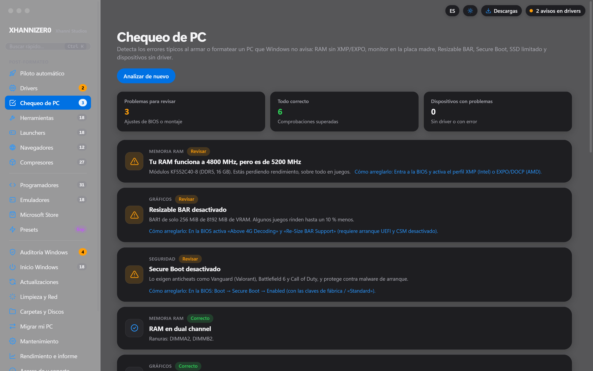

# Chequeo de PC

El **Chequeo de PC** detecta errores típicos al armar o formatear un equipo que Windows normalmente no avisa.


**Solo lectura:** el Chequeo de PC únicamente lee información del equipo y **no cambia ninguna configuración** ni instala nada por su cuenta.


## Cómo ejecutar el análisis

1. Ve a **Hardware → Chequeo de PC** en la barra lateral.
2. Haz clic en **Analizar mi PC**.
3. Revisa los resultados agrupados en tres contadores: **Problemas para revisar**, **Todo correcto** y **Dispositivos con problemas**.

## Qué revisa exactamente

- **Memoria RAM (XMP / EXPO / DOCP y canales):** comprueba si tu RAM corre por debajo de su velocidad nominal, si está en un solo canal (single channel) o si los módulos están en el mismo canal en lugar de dual channel.
- **Monitor conectado a la placa madre:** en PCs de escritorio con gráfica dedicada, avisa si conectaste el cable del monitor a la placa madre en lugar de a la tarjeta de video.
- **Frecuencia del monitor (Hz):** detecta pantallas de alta tasa de refresco (por ejemplo 144 Hz, 165 Hz o 240 Hz) que quedaron atascadas en 60 Hz tras formatear.
- **Resizable BAR:** verifica si la VRAM completa está accesible para el procesador.
- **SSD NVMe y ranura PCIe:** comprueba si tu SSD NVMe o tu tarjeta de video corren a menos velocidad o menos líneas PCIe de las que deberían.
- **Arranque UEFI, Secure Boot y TPM 2.0:** verifica el modo de arranque y los requisitos de seguridad que piden Windows 11 y anticheats modernos (como Vanguard, Battlefield o Call of Duty).
- **Virtualización en BIOS:** avisa si la virtualización (SVM / Intel VT-x) está desactivada cuando la necesites para WSL, Docker o máquinas virtuales.
- **Salud de discos, batería y estabilidad:** revisa el estado de tus discos, la salud de la batería en portátiles y si hubo pantallazos azules (BSOD) o apagados inesperados `Kernel-Power 41` en los últimos 30 días.
- **Dispositivos sin driver o con errores:** lista dispositivos con código de error en Windows y permite buscar su driver oficial (WHQL) en Windows Update por Hardware ID exacto.

## Solo sugiere lo que tu hardware soporta

XHANNIZER0 incluye un **motor de compatibilidad de hardware** que identifica tu GPU, procesador, chipset, placa madre y si tu equipo es portátil o de marca (OEM).

Gracias a esto evita falsos avisos:

- No te pide activar **Resizable BAR** si tu tarjeta gráfica o tu plataforma no lo soportan.
- Compara la velocidad de tu **SSD NVMe** contra el máximo real de tu placa madre y CPU (por ejemplo, si tu placa es PCIe 3.0 y tu SSD es PCIe 4.0, lo marca como óptimo al máximo de la placa).
- Reconoce placas o equipos de marca con **XMP/EXPO bloqueado** y portátiles (donde la RAM suele venir fija y la pantalla pasa por gráficos híbridos) para no mostrarte alertas innecesarias.
- No te manda a la BIOS a buscar **TPM 2.0** si tu generación de procesador no incluye fTPM/PTT 2.0 integrado.
- Ante un modelo desconocido o ambiguo, actúa de forma conservadora y evita falsas advertencias.

## Asistente de BIOS

Debajo del chequeo aparece el **Asistente de BIOS**, que te muestra la ruta exacta dentro de los menús de tu placa madre (**ASUS**, **MSI**, **Gigabyte / AORUS**, **ASRock** o equipos de marca como Dell, HP, Lenovo o Acer) y la tecla para entrar al encender.

- Por defecto muestra **solo** las guías de los puntos que el chequeo marcó para revisar (y que tu hardware realmente soporta).
- Si quieres consultar las 5 guías completas (XMP/EXPO, Resizable BAR, Secure Boot, TPM 2.0 y Virtualización), haz clic en **Ver todas las guías**.
- Si tu equipo arranca en modo UEFI, el botón **Reiniciar a la BIOS** reinicia Windows directamente al menú de la BIOS en 5 segundos, sin tener que apretar teclas al encender.


Los nombres de algunos menús pueden variar levemente según la versión de BIOS de tu placa. Al terminar tus cambios en la BIOS, guarda y sal con **F10**.

