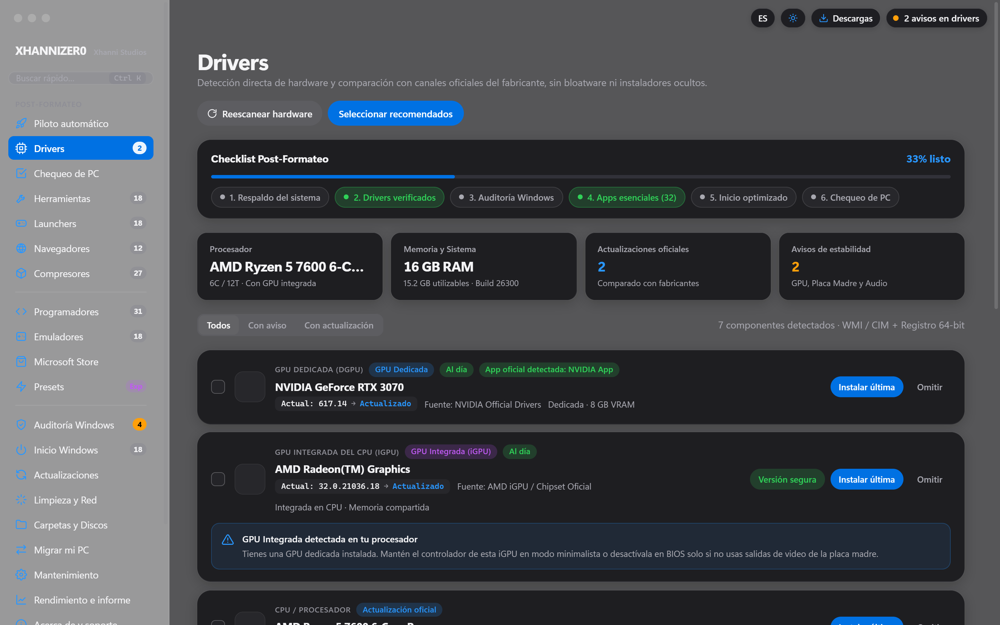

# Drivers y BIOS

La sección **Drivers y BIOS** detecta tu hardware real (procesador, tarjeta gráfica dedicada o integrada, placa madre, audio, red y discos) y compara los controladores instalados contra canales oficiales y Windows Update, sin bloatware ni instaladores ocultos.

## Qué muestra la pantalla

En la parte superior verás cuatro tarjetas de resumen:

- **Procesador** detectado.
- **Memoria y Sistema** (RAM total y versión de Windows).
- **Actualizaciones oficiales** disponibles.
- **Avisos de estabilidad** (cuando un driver de GPU, placa madre o audio tiene una advertencia conocida y conviene usar una versión segura).

## Filtros y acciones rápidas

Justo encima de la lista de dispositivos puedes usar:

- **Todos:** muestra todos los componentes detectados.
- **Con aviso:** filtra solo los componentes con algún aviso de estabilidad.
- **Con actualización:** muestra únicamente los drivers que tienen una versión más reciente disponible.
- **Reescanear hardware:** vuelve a leer los dispositivos y consultar si hay actualizaciones nuevas.
- **Seleccionar recomendados:** marca automáticamente los drivers recomendados para instalarlos en lote desde la barra inferior.

## Cómo instalar o actualizar un driver

1. En la tarjeta del dispositivo que tiene actualización disponible, haz clic en **Instalar última** (o en **Versión segura** si el componente muestra un aviso de estabilidad).
2. En la ventana de confirmación elige cómo prefieres actualizar:
   - **Instalar a través de XHANNIZER0 (Automático):** descarga e instala el controlador oficial dentro de la app sin abrir el navegador.
   - **Actualizar con la app oficial del fabricante:** abre la aplicación oficial detectada en tu equipo (por ejemplo, NVIDIA App o AMD Software).
3. Confirma la creación de la **copia de seguridad obligatoria** antes de avanzar.
4. Sigue el progreso y la verificación de firma digital en el panel **Descargas** (arriba a la derecha).


**«Todos tus drivers están al día»:** si un driver ya está actualizado, su tarjeta **no** muestra el botón de actualización para evitar reinstalaciones innecesarias. Cuando ningún componente necesita actualización tras escanear, XHANNIZER0 muestra un único aviso confirmando que **todos tus drivers están al día**.


## Omitir un driver y botones de placa madre

- Si prefieres no actualizar un componente concreto, puedes marcar **Omitir** en su tarjeta.
- En la tarjeta de la **placa madre** también encontrarás accesos útiles para **BIOS** y **chipset**, incluyendo la preparación de una memoria USB en FAT32 con BIOS verificada por SHA-256 en placas compatibles (XHANNIZER0 nunca flashea la BIOS desde Windows).


Actualizar la BIOS siempre debe hacerse desde el menú de la propia BIOS usando la memoria USB preparada, y con el equipo conectado a corriente estable.

