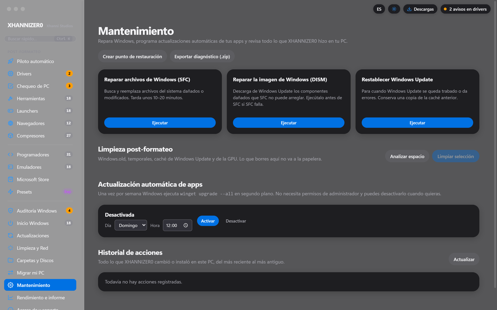

# Mantenimiento y limpieza

La sección **Mantenimiento** reúne herramientas para reparar Windows, preparar una memoria USB de instalación de Windows 11, liberar espacio tras formatear, programar actualizaciones semanales de tus apps y revisar el historial completo de acciones.

## Reparación de Windows y acciones rápidas

En la parte superior encontrarás:

- **Crear punto de restauración:** crea un punto de restauración real de Windows en cualquier momento.
- **Exportar diagnóstico (.zip):** genera un paquete técnico sin contraseñas ni archivos personales para compartir en soporte.
- **Reparaciones integradas:**
  - **Comprobador de archivos de sistema (`SFC`):** analiza y repara archivos dañados de Windows (`sfc /scannow`).
  - **Reparación de la imagen de Windows (`DISM`):** repara la imagen del sistema (`DISM /Online /Cleanup-Image /RestoreHealth`).
  - **Restablecer Windows Update:** reinicia los servicios de actualización (`wuauserv`, `bits`, `cryptsvc`, `msiserver`) y renombra las carpetas de caché de forma segura (garantizando siempre que los servicios queden activos al terminar).

## USB de instalación de Windows 11

Si necesitas preparar un pendrive para instalar Windows 11 desde cero:

1. Conecta una memoria USB de **8 GB o más** (todo su contenido se borrará).
2. En la tarjeta **USB de instalación de Windows 11**, haz clic en **Crear USB de Windows**.
3. XHANNIZER0 descarga la herramienta oficial de Microsoft (**Media Creation Tool**), verifica su firma digital y la abre para que completes el asistente oficial.


Asegúrate de respaldar cualquier archivo importante de tu memoria USB antes de iniciar: Microsoft Media Creation Tool formatea la unidad completa.


## Limpieza post-formateo

Permite liberar gigabytes de archivos innecesarios después de formatear o actualizar Windows:

1. Haz clic en **Analizar espacio** para calcular cuánto ocupa cada elemento.
2. Marca lo que quieras limpiar:
   - **Archivos temporales de tu usuario** *(marcado por defecto)*.
   - **Caché de sombreadores de la GPU** (DirectX, NVIDIA, AMD e Intel; se regenera sola) *(marcado por defecto)*.
   - **Temporales de Windows** *(marcado por defecto)*.
   - **Descargas de Windows Update** *(marcado por defecto)*.
   - **Instalación anterior de Windows (`Windows.old`)** *(desmarcado por defecto: si la borras ya no podrás volver a la versión anterior de Windows)*.
   - **Componentes reemplazados de Windows (`WinSxS`)** *(desmarcado por defecto; puede tardar varios minutos)*.
3. Presiona **Limpiar selección** y confirma.


Lo que borres en **Limpieza post-formateo** se elimina de forma permanente y **no va a la Papelera de reciclaje**. Revisa bien tus casillas antes de confirmar, especialmente `Windows.old`.


## Actualización automática de apps

Puedes programar que Windows actualice tus programas automáticamente una vez por semana con `winget upgrade --all` en segundo plano:

1. Elige el **Día** de la semana y la **Hora**.
2. Haz clic en **Activar**.
3. No requiere permisos de administrador y puedes desactivarlo en cualquier momento con **Desactivar**.

## Historial de acciones

Al final de la página verás el **Historial de acciones**, con un registro cronológico (del más reciente al más antiguo) de todo lo que XHANNIZER0 instaló o modificó en tu PC. Usa **Actualizar** para recargar la lista.
