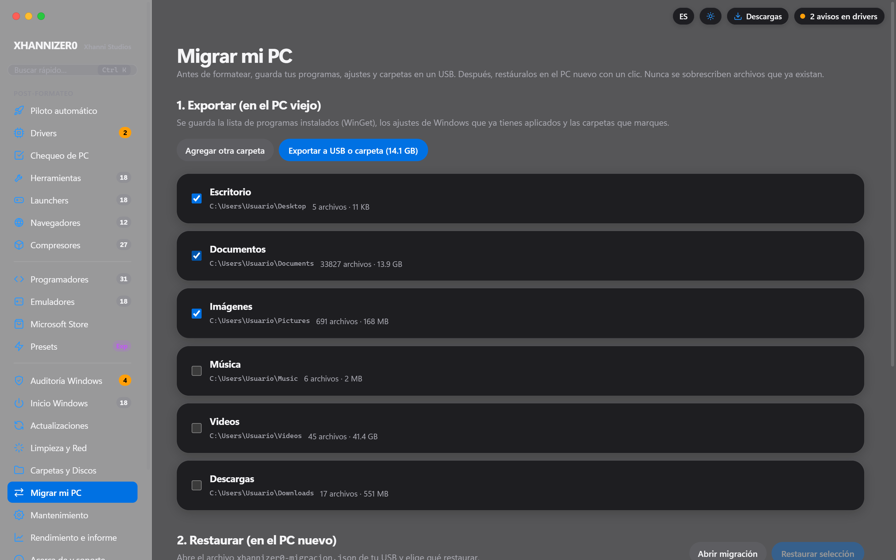

# Migrar mi PC

**Migrar mi PC** está pensado para cuando vas a formatear o cambiar de computadora. Te permite guardar tus programas, tus ajustes de Windows y tus carpetas importantes en un USB antes de formatear, y restaurarlos en el equipo nuevo con un clic.


**Tus archivos siempre seguros:** al restaurar carpetas en el equipo nuevo, XHANNIZER0 **nunca sobrescribe archivos que ya existan**.


## 1. Exportar (en el PC viejo)

1. Ve a **Sistema → Migración y Técnico → Migrar mi PC**.
2. Marca las carpetas personales que quieras llevar contigo. Si necesitas incluir otra ruta, haz clic en **Agregar otra carpeta**.
3. Presiona **Exportar a USB o carpeta** y elige tu memoria USB o disco externo.
4. XHANNIZER0 guardará:
   - La lista de programas instalados (vía WinGet).
   - Los ajustes de Windows que ya tienes aplicados.
   - Una medición de estado («Antes») si corresponde, para compararla después de formatear.
   - Las carpetas que marcaste, junto con el archivo `xhannizer0-migracion.json`.

## 2. Restaurar (en el PC nuevo)

1. Instala y abre XHANNIZER0 en el PC recién formateado y conecta tu USB.
2. Ve a **Migrar mi PC** y haz clic en **Abrir migración**.
3. Selecciona el archivo `xhannizer0-migracion.json` de tu USB.
4. Elige exactamente qué programas, ajustes y carpetas quieres traer de vuelta.
5. Presiona **Restaurar selección** y confirma el proceso.

## 3. Compartir perfil con código, enlace o QR

Si solo quieres compartir tu selección de programas y los ajustes que ya aplicaste (con un amigo, un cliente o para tu otro PC) sin copiar archivos ni crear cuentas:

1. Haz clic en **Generar y copiar código**.
2. Verás un código de texto que empieza con `XHZ1-…`, junto con un **código QR** y el botón **Copiar enlace**.
3. Quien reciba el código puede pegarlo en **Importar código** (o en el [Piloto automático](piloto-automatico.md)) para revisar la lista antes de instalar. Nada se aplica sin confirmación.


**Privacidad en el enlace:** al compartir mediante enlace, el código `XHZ1-…` va después del símbolo `#`, por lo que ningún servidor web recibe tu lista de programas ni ajustes.

