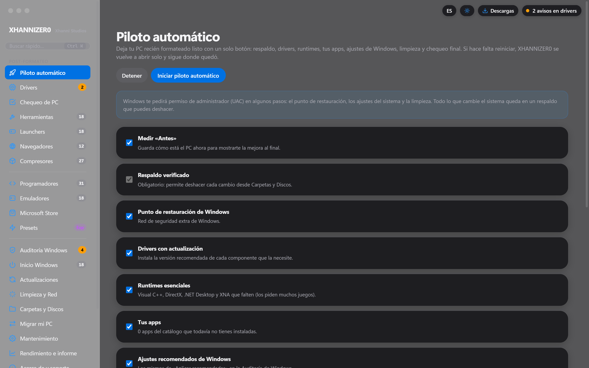

# Piloto automático

El **Piloto automático** deja un PC recién formateado listo de principio a fin con un solo botón. Ejecuta los pasos en orden, guarda tu progreso en disco y, si hace falta reiniciar después de instalar drivers, vuelve a abrir XHANNIZER0 automáticamente para continuar donde quedó.

## Pasos que ejecuta (en orden)

Puedes activar o desactivar cada paso antes de empezar, excepto el **Respaldo verificado**, que es obligatorio:

1. **Medir «Antes»:** guarda el estado inicial del PC para compararlo al final en [Rendimiento e informe](rendimiento-e-informe.md).
2. **Respaldo verificado (obligatorio):** crea una copia de seguridad en disco para poder deshacer cualquier cambio desde [Carpetas y discos](carpetas-y-discos.md).
3. **Punto de restauración de Windows:** crea un punto de restauración nativo como red de seguridad extra.
4. **Drivers con actualización:** instala la versión recomendada de cada componente que necesite actualización.
5. **Runtimes esenciales:** instala los paquetes faltantes de Visual C++, DirectX, .NET Desktop y XNA que requieren muchos juegos y programas.
6. **Tus apps:** instala los programas que hayas marcado en el [Catálogo](catalogo.md) o los que cargues mediante un código de perfil.
7. **Ajustes recomendados de Windows:** aplica los mismos ajustes recomendados que aparecen en la [Auditoría de Windows](auditoria-de-windows.md).
8. **Quitar anuncios de Windows 11** *(desactivado por defecto)*: opcionalmente limpia anuncios del menú Inicio, Bing en la búsqueda, widgets, Recall y sugerencias.
9. **Limpieza post-formateo:** limpia temporales de usuario, temporales de Windows, caché de Windows Update y caché de sombreadores de la GPU. No toca `Windows.old`.
10. **Chequeo de PC final:** ejecuta el análisis de XMP/EXPO, Resizable BAR, Secure Boot y dispositivos sin driver.
11. **Medir «Después»:** toma la medición final para mostrar la mejora en [Rendimiento e informe](rendimiento-e-informe.md).

## Cómo usarlo paso a paso

1. (Opcional) Si quieres instalar un conjunto de programas específico, márcalos antes en el [Catálogo](catalogo.md) o pega un código de perfil `XHZ1-…` en el campo **Código de perfil (opcional)** y haz clic en **Cargar código**.
2. Revisa la lista de pasos y marca o desmarca los que quieras incluir.
3. Haz clic en **Iniciar piloto automático**.
4. Confirma el respaldo obligatorio y espera a que avance la barra de progreso.


Si activaste el [Modo administrador](primeros-pasos/modo-administrador.md) antes de iniciar, no tendrás que aceptar avisos UAC repetidos durante el proceso.


## Detener el proceso

Mientras el Piloto automático está en marcha aparece el botón **Detener** arriba a la derecha. Al presionarlo, el flujo se detiene de forma segura al terminar la tarea actual y guarda qué pasos ya quedaron listos.

## Si hace falta reiniciar para terminar los drivers

Cuando alguno de los drivers instalados requiere reinicio, el Piloto automático se pausa y te ofrece dos opciones:

- **Reiniciar y continuar:** programa el reinicio del PC en 15 segundos. Al volver a iniciar sesión en Windows, XHANNIZER0 se abre solo y retoma exactamente el siguiente paso pendiente.
- **Seguir sin reiniciar:** continúa de inmediato con el resto de los pasos sin reiniciar todavía.


Si eliges **Seguir sin reiniciar**, recuerda reiniciar Windows manualmente al terminar todo el Piloto automático para que los drivers nuevos entren en efecto.

