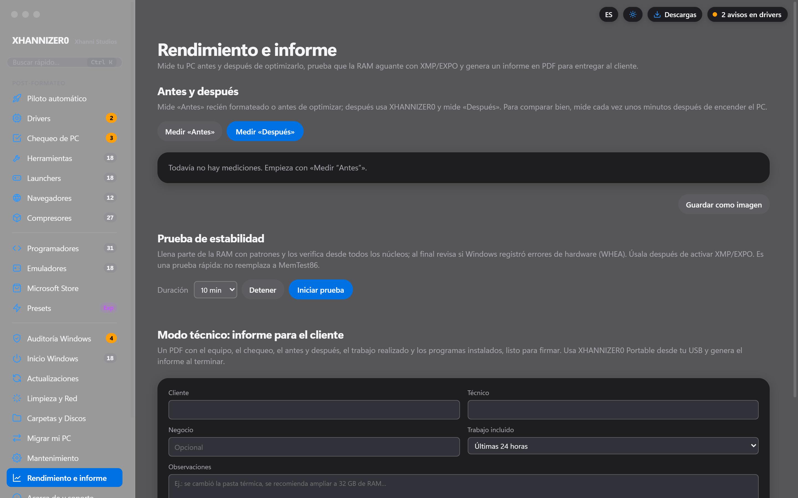

# Rendimiento e informe

La sección **Rendimiento e informe** te permite comprobar con números reales cuánto mejoró tu PC, verificar que la memoria RAM sea estable tras activar XMP/EXPO y generar un informe profesional en PDF.

## 1. Antes y después

Esta herramienta guarda dos fotografías del estado de tu PC para compararlas lado a lado:

- Tiempo de arranque de Windows.
- RAM usada en reposo.
- Cantidad de procesos en ejecución y servicios activos.
- Programas al inicio.
- Uso de CPU en reposo.
- Espacio libre en el disco del sistema.

### Cómo medir correctamente

1. Antes de optimizar (o recién formateado), espera unos minutos después de encender el PC y haz clic en **Medir «Antes»**.
2. Realiza tus optimizaciones, limpieza o ajustes con XHANNIZER0 (y reinicia si corresponde).
3. Unos minutos después de encender el PC de nuevo, haz clic en **Medir «Después»**.
4. Si quieres guardar el resultado visual para compartirlo o archivarlo, presiona **Guardar como imagen**.


Si migraste desde otro PC con [Migrar mi PC](migrar-mi-pc.md) o ejecutaste el [Piloto automático](piloto-automatico.md), la medición «Antes» se importa o se toma automáticamente.


## 2. Prueba de estabilidad de RAM

Sirve para comprobar que tu memoria RAM aguanta sin errores después de activar XMP, EXPO o DOCP en la BIOS.

1. Selecciona la **Duración** (**2**, **5**, **10**, **20** o **30 minutos**; por defecto 10 min).
2. Haz clic en **Iniciar prueba**.
3. XHANNIZER0 llena parte de la RAM con patrones de prueba, los verifica desde todos los núcleos del procesador y al final revisa si Windows registró errores de hardware (**WHEA**).
4. Puedes cancelar en cualquier momento con **Detener**.


Es una prueba rápida de verificación post-BIOS: **no reemplaza a MemTest86** para diagnósticos profundos de módulos defectuosos.


## 3. Informe PDF (Modo técnico)

Pensado para técnicos de soporte o talleres que quieren entregar un comprobante claro y profesional al cliente.


Esta sección aparece cuando **Modo técnico** está activado en [Ajustes](ajustes-y-acerca.md) (viene activado por defecto).


Para generar el informe:

1. Completa los campos **Cliente**, **Técnico** y **Negocio** (opcional).
2. Elige el periodo de **Trabajo incluido** (**Últimas 24 horas**, **Últimos 7 días** o **Todo el historial**).
3. Agrega **Observaciones** si lo deseas (por ejemplo: *«Se cambió la pasta térmica, se recomienda ampliar a 32 GB de RAM»*).
4. Haz clic en **Generar informe PDF** y elige dónde guardar el archivo.

El PDF se genera localmente en tu PC (sin subir nada a internet) e incluye las especificaciones del equipo, el chequeo de PC, la comparativa antes y después, el trabajo realizado y los programas instalados, listo para firmar.
